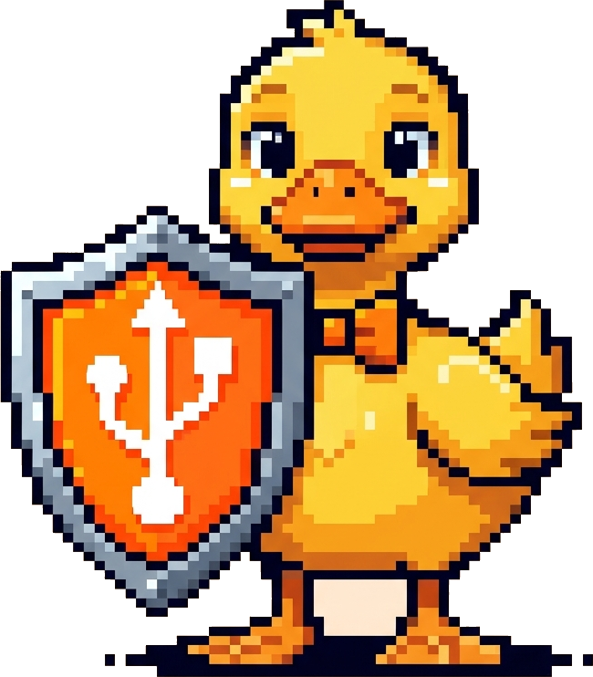

# Claude Handoff: DuckyGuard. Product Integration on shindustries.co

> **Correction (2026-10-26, branch v2-polish):** this handoff was written before the claims audit.
> Several statements below are not true of the code: there is no "Pro" tier, no $19 license, no PCAP/hex
> viewer, no "enterprise exporter", no "sub-100 ms" measurement, and the app is Python + PyObjC (the Swift
> host is retired under `legacy/`). The version is 2.0.0, not 2.4.0. Use `docs/FEATURES.md` as the only
> source for product claims and `docs/EVALUATION.md` for numbers. The brand tokens in section 3 still apply.

> **Directive for Claude**: Steven Hainley has engineered **DuckyGuard.** — an autonomous physical endpoint defense app for macOS that halts BadUSB / Flipper Zero HID injection attacks before a malicious shell opens. 
> 
> Your mission is to integrate DuckyGuard into Steven's main website portfolio (`shindustries.co` / `stevenhainley.net`) under the **Products** section alongside **Glim**, and configure its deployment to a dedicated subdomain (`duckyguard.shindustries.co`).

---

## 1. Executive Summary & Product Overview

- **Product Name**: `DuckyGuard.` (always stylized with the trailing dot in matte orange `#FF6B00`).
- **Parent Brand**: `sh. industries` (Design System v2.0 Foreman Standard).
- **Founder & Architect**: Steven Hainley (Cybersecurity BS at WPI, Class of 2029; Law & Technology minor).
- **Core Technology**: 
  - macOS user-space IOKit USB event tap + WindowServer focus-snatching decoy sandbox.
  - Sub-100ms hardware HID injection quarantine (neutralizes Flipper Zero, USB Rubber Ducky, MalDuino, Bash Bunny).
  - Biometric typing entropy filter (differentiates rapid human key spam from machine-timed payloads).
  - Built in Swift 5 + Python 3.12, zero kernel extensions (KEXTs) required.
- **Business & Pricing Model**:
  - **Community Edition ($0 Free Forever)**: Real-time HID interception, focus-stealing quarantine sink, local telemetry logging, native macOS menu bar app.
  - **DuckyGuard Pro ($19 One-Time Lifetime Fee)**: Automated YARA rule synthesis, MITRE ATT&CK enterprise exporter, raw packet hex dump & PCAP viewer, Hardware USB Whitelist Manager (device locking).

---

## 2. Asset & Website Locations on Disk

All static web assets, fonts, and the standalone product page are pre-built and staged at:

| Path | Purpose |
| :--- | :--- |
| `/Users/stevenhainley/DuckyGuard/website/index.html` | Canonical source for DuckyGuard standalone landing page |
| `/Users/stevenhainley/sh-stack/products/duckyguard/index.html` | Staged copy in `sh-stack` for deployment |
| `/Users/stevenhainley/sh-stack/products/duckyguard/assets/` | High-res mascot, isolated USB shield duck, retina menu icons |
| `/Users/stevenhainley/sh-stack/products/duckyguard/fonts/` | Offline `Funnel Display` and `Funnel Sans` TTF files |
| `/Users/stevenhainley/DuckyGuard/assets/duck_isolated_usb.png` | Official pixel mascot (yellow duck + matte orange `#FF6B00` shield with USB trident) |
| `/Users/stevenhainley/DuckyGuard/assets/menubar_icon.png` | 20×18 & 40×36 retina menu bar icons |
| `/Users/stevenhainley/Applications/DuckyGuard.app` | Installed, tested, running macOS desktop application bundle |

---

## 3. Brand Tokens & Design System Guidelines

Strict adherence to the `sh. industries` design tokens (`tokens.v2.json`) is required:

- **Typography**:
  - Headings / Display: `Funnel Display`, weights 700 / 800.
  - Body & UI: `Funnel Sans`, weights 400 / 500 / 600.
  - Code / Telemetry: `ui-monospace`, `SFMono-Regular`, `Menlo`, monospace.
- **Palette**:
  - Background Canvas: `#FDFBF7` (Warm ivory paper).
  - Raised Surface: `#FFFFFF` (Pure white card).
  - Subtle Surface: `#FAF6EF` / `#FFF8EB`.
  - Hairlines / Borders: `#E8E2D5`.
  - Body Text: `#1C1917` (Deep stone ink).
  - Muted Text: `#78716C`.
  - **Matte Shield Orange**: `#FF6B00` (RGB: 255, 107, 0). **Strictly solid matte, no gradients!**
  - Duck Yellow: `#FFB800`.
- **Wordmark Specification**:
  ```html
  <div class="brand-wordmark">
    <span style="color: #FF6B00; font-weight: 800;">Ducky</span><span style="color: #1C1917; font-weight: 800;">Guard</span><span style="color: #FF6B00; font-weight: 800;">.</span>
  </div>
  ```

---

## 4. Subdomain Deployment Architecture

The standalone site should be deployed to a dedicated subdomain:
**`duckyguard.shindustries.co`** (or `duckyguard.stevenhainley.net`).

### Option A: Cloudflare Pages / Workers (Recommended)
1. In Cloudflare Dashboard, create a new Cloudflare Pages project named `duckyguard`.
2. Connect to the repository or upload the directory:
   - Root directory: `products/duckyguard` (or `website/`).
   - Build command: *(None - pure zero-dependency static HTML/CSS/JS)*.
   - Output directory: `.`.
3. Add custom domain: `duckyguard.shindustries.co`.
4. Cloudflare will automatically provision SSL/TLS with HTTP/2 and edge caching.

### Option B: GitHub Pages / Custom CNAME
1. Inside `/Users/stevenhainley/sh-stack/products/duckyguard/CNAME`:
   ```text
   duckyguard.shindustries.co
   ```
2. Configure DNS in Cloudflare / Namecheap:
   - Type: `CNAME`
   - Name: `duckyguard`
   - Content: `stevenhainley.github.io` (or your Pages host)
   - Proxy status: Proxied (Orange cloud).

---

## 5. Main Site Integration: Adding DuckyGuard alongside Glim

In `shindustries.co` / `stevenhainley.net` (e.g. `site-net/index.html` or the global navigation header and products grid):

### A. Navigation Menu / Dropdown Link
Add DuckyGuard to the Products dropdown:
```html
<!-- In the Products navigation dropdown -->
<div class="nav-products-menu">
  <!-- Glim -->
  <a href="https://shindustries.co/glim" class="product-menu-item">
    <div class="item-icon glim-icon"></div>
    <div class="item-info">
      <div class="item-title">Glim</div>
      <div class="item-tagline">Autonomous context assistant & second brain</div>
    </div>
  </a>

  <!-- DuckyGuard -->
  <a href="https://duckyguard.shindustries.co" class="product-menu-item" target="_blank" rel="noopener">
    
    <div class="item-info">
      <div class="item-title">DuckyGuard<span style="color:#FF6B00;">.</span> <span class="badge-free">Free + Pro</span></div>
      <div class="item-tagline">Physical endpoint defense & BadUSB neutralization</div>
    </div>
  </a>
</div>
```

### B. Products Grid Card Component
Place this card in the Products section of the homepage:
```html
<!-- DuckyGuard Product Showcase Card -->
<article class="sh-product-card" style="background:#FFFFFF; border:1px solid #E8E2D5; border-radius:16px; padding:28px; display:flex; flex-direction:column; gap:18px; box-shadow:0 2px 10px rgba(28,25,23,0.04); transition:transform 0.2s ease, box-shadow 0.2s ease;">
  <div style="display:flex; justify-content:space-between; align-items:center;">
    <div style="display:flex; align-items:center; gap:12px;">
      
      <h3 style="font-family:'Funnel Display', sans-serif; font-size:22px; font-weight:800; color:#1C1917; margin:0; letter-spacing:-0.03em;">
        <span style="color:#FF6B00;">Ducky</span>Guard<span style="color:#FF6B00;">.</span>
      </h3>
    </div>
    <span style="font-family:'Funnel Sans', sans-serif; font-size:11px; font-weight:600; text-transform:uppercase; letter-spacing:0.05em; background:#FFF8EB; color:#FF6B00; padding:4px 10px; border-radius:100px; border:1px solid rgba(255,107,0,0.2);">
      macOS ARM64
    </span>
  </div>

  <p style="font-family:'Funnel Sans', sans-serif; font-size:14px; line-height:1.6; color:#78716C; margin:0;">
    Autonomous physical HID injection defense. Detects rogue USB keystroke bursts from Flipper Zero and Rubber Ducky, pre-empting WindowServer focus into a secure sandbox under 100ms.
  </p>

  <div style="display:flex; align-items:baseline; gap:8px; margin-top:auto;">
    <span style="font-family:'Funnel Display', sans-serif; font-size:20px; font-weight:800; color:#1C1917;">Free</span>
    <span style="font-family:'Funnel Sans', sans-serif; font-size:13px; color:#A8A29E;">/ Community</span>
    <span style="font-family:'Funnel Sans', sans-serif; font-size:12px; color:#78716C; margin-left:auto;">$19 Lifetime Pro</span>
  </div>

  <div style="display:flex; gap:10px; margin-top:6px;">
    <a href="https://duckyguard.shindustries.co" target="_blank" rel="noopener" style="flex:1; text-align:center; padding:10px 16px; background:#FF6B00; color:#FFFFFF; border-radius:8px; font-family:'Funnel Sans', sans-serif; font-size:13px; font-weight:600; text-decoration:none; transition:background 0.15s ease;">
      Explore DuckyGuard. →
    </a>
  </div>
</article>
```

---

## 6. Payment & Distribution Links

1. **Stripe Checkout for DuckyGuard Pro ($19 One-Time)**:
   - Configure a Stripe Payment Link product:
     - Name: `DuckyGuard Pro Lifetime License`
     - Price: `$19.00 USD` (One-time payment)
     - Link target: `https://buy.stripe.com/duckyguard-pro` (or your live Stripe link).
   - Post-purchase redirect: `https://duckyguard.shindustries.co/pro/welcome` with license key dispatch.
2. **Binary Releases (macOS Universal ARM64)**:
   - Release package: `DuckyGuard.dmg` (or GitHub Release tag `v2.4.0`).
   - Binary path: `/Users/stevenhainley/Applications/DuckyGuard.app`.

---

## 7. Verification Checklist for Claude

- [ ] `DuckyGuard.` wordmark is rendered with solid matte orange `#FF6B00` on the dot (`.`) and on the `Ducky` portion.
- [ ] No gradients are used on the shield or logo.
- [ ] Subdomain `duckyguard.shindustries.co` serves `/Users/stevenhainley/sh-stack/products/duckyguard/index.html`.
- [ ] Interactive Oscilloscope and Keystroke Threat Simulator load smoothly at 60 FPS in browser.
- [ ] Products navigation on `shindustries.co` lists both **Glim** and **DuckyGuard.**.
- [ ] Pricing model clearly articulates: **Free Community Edition** ($0) vs. **Pro Lifetime** ($19).
- [ ] Founder credit is maintained: *Steven Hainley · Cybersecurity (BS) at WPI*.
