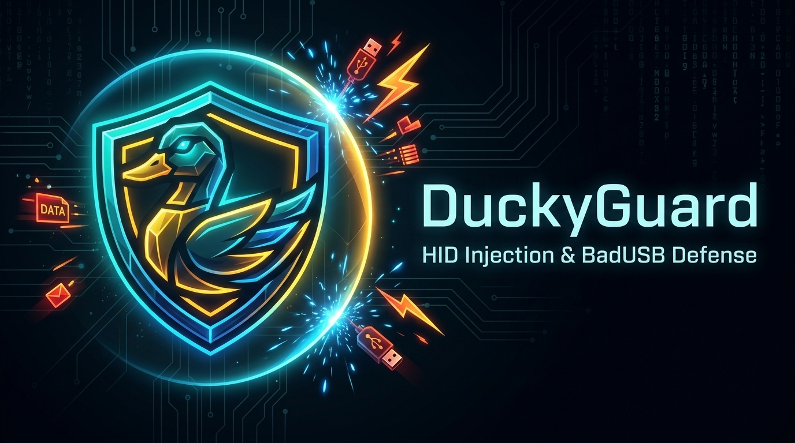

<p align="center">
  
</p>

<p align="center">
  <strong>Autonomous Endpoint Defense Against Physical HID Injection & BadUSB Attacks</strong>
</p>

<p align="center">
  
  
  
  
  
</p>

---

## 🎯 Overview

**DuckyGuard** is an open-source endpoint defense system engineered to detect, intercept, and neutralize physical **Human Interface Device (HID) injection attacks** (such as the **Hak5 Rubber Ducky**, **Flipper Zero BadUSB**, and **Raspberry Pi Pico** injectors).

Traditional Antivirus and EDR (CrowdStrike, Defender, SentinelOne) suffer from a fundamental architectural blindspot: **the operating system kernel inherently trusts keyboards**. When a malicious USB microcontroller is plugged in, it emulates a keyboard and injects shell payloads at over 100 characters per second. By the time an EDR tool detects a child process spawn, the attacker's payload has already executed.

**DuckyGuard stops the attack before the first command executes.**

```
┌─────────────────────────────────────────────────────────────────────────┐
│                      The DuckyGuard Defense Flow                        │
│                                                                         │
│   [Flipper Zero / Rubber Ducky]                                         │
│                │                                                        │
│                ▼                                                        │
│   1. USB Watcher correlates new HID device attachment (IOKit)           │
│                │                                                        │
│                ▼                                                        │
│   2. Keystroke Dynamics Engine calculates Velocity + Timing Jitter      │
│                │                                                        │
│                ▼ (Confidence ≥ 0.70 within ~100ms)                     │
│   3. Decoy Sink preempts WindowServer focus into a secure sandbox       │
│                │ (Keystrokes trapped in sandbox; Enter never hits shell)│
│                ▼                                                        │
│   4. Forensic Analyzer extracts IOCs & builds automated YARA rules     │
└─────────────────────────────────────────────────────────────────────────┘
```

---

## ✨ Key Features

- **Multi-Factor Keystroke Dynamics**:
  - **Velocity Analysis**: Differentiates human typing limits ($< 15\text{ cps}$) from microcontroller bursts ($40–120\text{ cps}$).
  - **Inter-Keystroke Interval (IKI) Jitter**: Analyzes biometric entropy. Human typing has natural timing variance ($\sigma \ge 35\text{ms}$); synthetic firmware loops have near-zero jitter ($\sigma < 8\text{ms}$).
- **Temporal USB Correlation**:
  - Monitors the macOS IOKit USB bus for newly enumerated HID devices. If rapid typing begins within 5 seconds of a keyboard insertion, threat confidence surges.
- **Active Decoy Quarantine Sink**:
  - Hijacks macOS `keyWindow` focus immediately using a topmost containment window.
  - Sinks the remaining attacker keystrokes safely into an isolated sandbox buffer, preventing commands from ever executing in Terminal or Spotlight.
- **Automated Threat Intelligence & Triage**:
  - Extracts Indicators of Compromise (IOCs): C2 IP addresses, dropper URLs, and file paths.
  - Automatically de-obfuscates base64 / encoded strings.
  - Maps attacks directly to the **MITRE ATT&CK® framework** (`T1200`, `T1059`, `T1105`, `T1071`).
  - Automatically compiles an actionable **YARA detection signature** for endpoint fleet distribution.
- **Native macOS Menu Bar App**:
  - Lightweight menu bar interface (`rumps`) showing live telemetry, attack logs, and quick arm/disarm toggles.
- **Built-in Attack Simulator**:
  - Includes a synthetic BadUSB injector for safely testing and demonstrating endpoint defenses without physical hardware.

---

## 🚀 Quick Start

### 1. Prerequisites
- **macOS** 12.0+ (Apple Silicon or Intel)
- **Python** 3.9+
- **macOS Accessibility Permission**: Required to monitor global keyboard events. When prompted, allow Terminal / Python in:
  `System Settings` → `Privacy & Security` → `Accessibility`

### 2. Installation

```bash
# Clone the repository
git clone https://github.com/stevenhainley/DuckyGuard.git
cd DuckyGuard

# Install dependencies
pip3 install -e .
```

### 3. Usage

#### Start Protection in Terminal
```bash
python3 -m duckyguard.cli start
```

#### Launch Native Menu Bar App
```bash
python3 -m duckyguard.cli tray
```

#### Test Defense (Built-in Attack Simulator)
You can verify DuckyGuard immediately without plugging in a physical Flipper Zero:

```bash
# Fire a synthetic BadUSB payload (drops in 3 seconds)
python3 -m duckyguard.cli simulate --preset resume_dropper

# Verify that benign human typing is NEVER flagged
python3 -m duckyguard.cli simulate --human
```

#### View Intercepted Incident Reports
```bash
python3 -m duckyguard.cli reports
```

---

## 📊 Sample Incident Report & YARA Rule

When an attack is intercepted, DuckyGuard generates a full triage report in `reports/`:

```markdown
# 🛡 DuckyGuard Incident Response Report

**Incident ID**: `DG-INC-20261026-192500`  
**Threat Status**: 🟢 NEUTRALIZED & CONTAINED (Zero Command Execution)  
**Attacker Device**: `Flipper Zero (STMicroelectronics)`  
**Injection Velocity**: `72.4 keystrokes/sec` (Confidence: 98%)  

### MITRE ATT&CK® TTP Matrix
| Technique ID | Technique Name | Observation Details |
| :--- | :--- | :--- |
| `T1200` | Hardware Additions | Physical HID emulation device inserted |
| `T1059.004` | Command and Scripting Interpreter: Unix Shell | Attempted execution of bash/zsh commands |
| `T1105` | Ingress Tool Transfer | Automated remote payload retrieval (curl) |

### Indicators of Compromise (IOCs)
- **Dropper URL**: `https://attacker-infrastructure.com/stage1.sh`
- **C2 IP**: `198.51.100.42`
```

Along with an automated YARA detection signature:
```yara
rule DuckyGuard_BadUSB_Payload_20261026_192500
{
    meta:
        description = "Automated rule generated by DuckyGuard for intercepted BadUSB payload"
        threat_type = "BadUSB / HID Injection Dropper"
        mitre_technique = "T1200, T1059"

    strings:
        $url1 = "https://attacker-infrastructure.com/stage1.sh" ascii wide
        $ip1 = "198.51.100.42" ascii
        $cmd1 = "curl" ascii nocase
        $cmd2 = "chmod +x" ascii nocase

    condition:
        any of them
}
```

---

## 📚 Technical Documentation

For in-depth explanations of the OS focus model, timing algorithms, and threat scenarios:
- **[Architecture & Engineering Deep Dive](docs/ARCHITECTURE.md)**
- **[Threat Model & Attack Surface](docs/THREAT_MODEL.md)**

---

## 👨‍💻 Author

**Steven Hainley**  
*Cybersecurity Student, Worcester Polytechnic Institute (WPI)*  
*Minor in Law and Technology*  
GitHub: [@stevenhainley](https://github.com/stevenhainley)  

---

## ⚖️ License

Distributed under the **MIT License**. See `LICENSE` for details.
