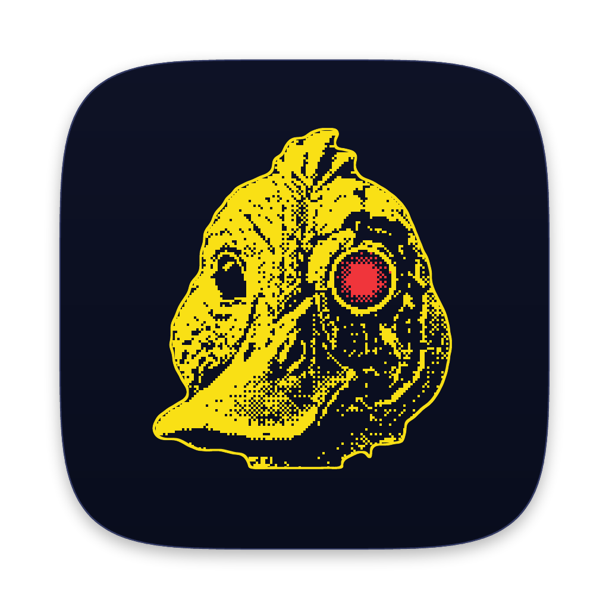
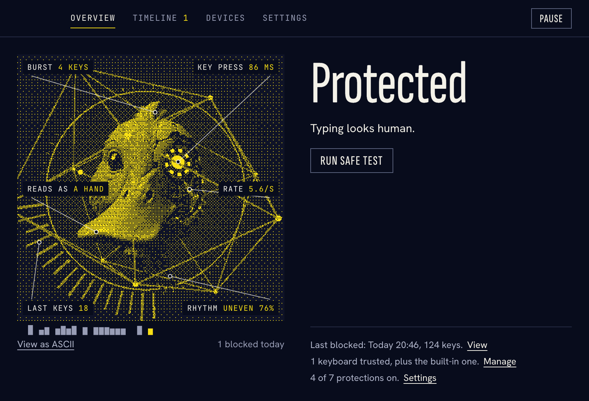
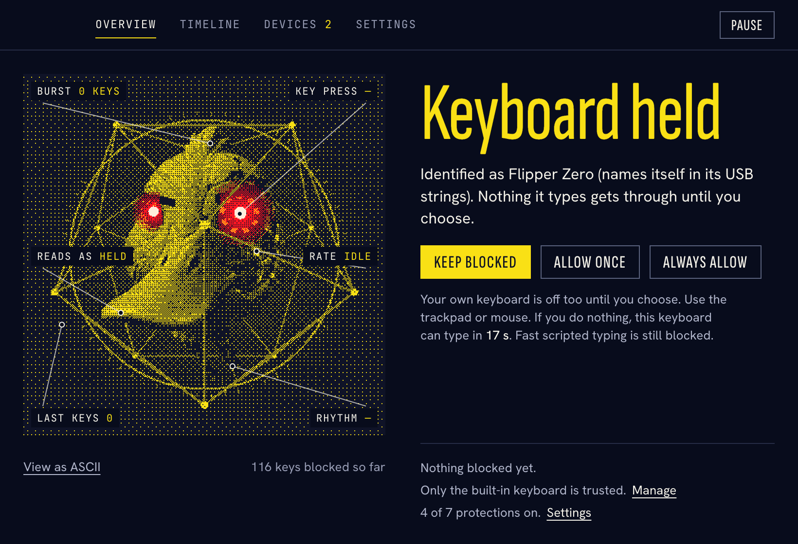
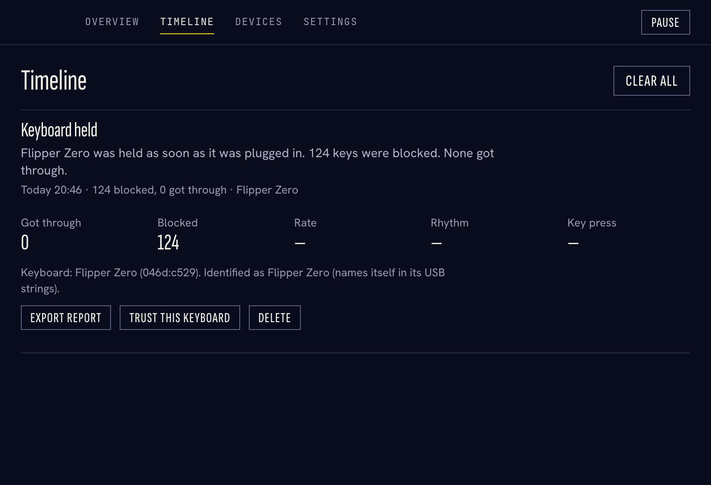

<p align="center">
  
</p>

<h1 align="center">DuckyGuard</h1>

<p align="center"><strong>Keyboards that type too fast get stopped.</strong><br>
A free macOS menu bar app that blocks keystroke-injection devices (Rubber Ducky, Flipper Zero BadUSB, pico-ducky, O.MG cable) by the rhythm of their typing.</p>

<p align="center">
  
  
  
</p>

---

## What it does

A USB device can claim to be a keyboard and type a command in under a second.
macOS, like every OS, trusts keyboards. DuckyGuard times every key on the Mac.
When a burst is faster and more even than any hand, or its keys are let go
faster than a finger can, it blocks the rest of that burst inside the system
event tap, before the keys get through to an application, and tells you why
in a sentence:

> A keyboard pressed 6 keys in a row and let go of each within 1 ms. A finger holds a key 60-150 ms. DuckyGuard blocked it.

- **Holds new keyboards.** The moment a keyboard you have not trusted is plugged in, every key is blocked until you choose: Keep blocked, Allow once or Always allow. You choose with the trackpad or mouse. On a Flipper Zero, 0 of 124 characters got through in three hardware runs. Your own keyboard is off during the hold too, because macOS does not say which keyboard a key came from. If nobody chooses, the hold ends after the hold length (20 s by default; 1 min and 2 min are in Settings) and the keyboard may type, still untrusted and still subject to the timing rules.
- **Blocks, not just warns.** With the Accessibility permission, blocked keys never get through to any app. With only Input Monitoring the status reads "Can't block" and DuckyGuard can only warn.
- **Explains every block.** Rate, rhythm, key press time, burst length, the text of the burst and whether an untrusted keyboard had just appeared.
- **Catches Spotlight openers and jittered droppers.** Tracks hardware `Cmd+Space` chords across Spotlight's open delay so a fast terminal opener (`terminal`, `iterm`, `warp`) is blocked at the 6th character before Return launches the app, and catches jittered macOS/Unix dropper commands (`curl`, `python -c`, `security find-*-password`, `xattr -d com.apple.quarantine`, `launchctl`) up to 25% timing variation.
- **Lockdown mode.** One click in the menu bar or Settings (or `duckyguard lockdown on`) holds every external keyboard plugged in afterwards, trusted ones included, with no 20-second expiry. Built for working away from your desk keyboard when an attacker could clone a trusted USB identity.
- **Names what it sees.** A built-in table of default identities for injection boards (Flipper Zero, Bash Bunny, P4wnP1, Digispark, Pico, Arduino, SparkFun Pro Micro, Seeed XIAO, Teensy and more, each with its source) and vendor names from the USB ID database. A device using a big brand's vendor id under another maker's name is flagged.
- **Lookalike and fingerprint check.** Each trusted keyboard's normalized USB/HID descriptor is pinned with a SHA-256 fingerprint. A second copy of a keyboard you trust, a trusted name with a changed serial number or altered USB descriptor strings, or a lookalike of a trusted model is treated as untrusted and held.
- **Knows your keyboards.** First run offers to trust the keyboards connected at that moment, so they are never held. Devices lists every connected keyboard from IOKit with Trust and Stop trusting.
- **Leaves software typing alone.** Password managers, text expanders and dictation type like machines on purpose; their events carry a process id and are labelled, not blocked.
- **Safe test.** One click types one harmless sentence at 12 ms per key so you can watch a block happen. No hardware needed. The sentence contains no command, the test never presses Return, it types only while DuckyGuard's own window is the key window, and it stops if that window loses focus.
- **Says when it is not protecting.** The window and the menu bar use the same words: Protected, Keyboard held, Blocking, Paused, Can't block, Recording only, Not protected. The menu bar icon changes when DuckyGuard is installed but cannot block.
- **Timed pause.** Pause for 5 minutes, for 1 hour, or until you resume. A timed pause ends on its own.
- **Private.** Incidents, trusted keyboards, settings and a SHA-256 hash-chained `audit.jsonl` event log live in `~/Library/Application Support/DuckyGuard` with owner-only permissions (`0700`/`0600`). The only network request is an opt-in, once-a-day update check.
- **Scriptable.** `duckyguard incidents --json` prints one JSON object per incident; `duckyguard audit --verify` verifies the SHA-256 hash chain across `audit.jsonl`; `duckyguard devices --export` and `--import` move pinned trust policies between Macs; `duckyguard export <id> --format ocsf` writes an OCSF Detection Finding for a SIEM.
- **Exportable.** One click writes a Markdown incident report; indicators, a MITRE ATT&CK mapping and a YARA rule are included only when the captured text actually contains something to base them on.

## What it does not do (limits)

Read this before relying on it.

- **The first keys get through.** On a Flipper Zero, timing alone let 3 to 5 characters through before the block in five of six hardware runs; the sixth let 1 through because an earlier block had already primed the detector (see `docs/EVALUATION.md` and `bench/hardware/results/2026-11-10-flipper-zero.json`). A payload short enough to finish in that many keys is not stopped. Without key press timing, the decision falls back to the 6th to 20th key.
- **A payload scripted to hold keys like a finger is not caught.** Injectors let go of each key within a millisecond or two, and DuckyGuard blocks on that even when the gaps are randomised. A device that holds every key 60 ms or more and types at 8-12 keys a second with random gaps looks human on every signal DuckyGuard measures. It also needs a minute at the keyboard.
- **The hold lasts 20 seconds.** A new keyboard is held for 20 s unless you allow it (away mode holds until you are back). Because macOS does not tell which keyboard sent a key, every hardware keyboard is paused during the hold, so normal mode fails open to avoid locking you out if a false trigger or trackpad issue occurs. If you do nothing, it can type after the countdown, and a payload that waits out the hold faces the timing rules alone. In the three hold runs the Flipper typed 1.2 to 3.5 s after plug-in, inside the hold, and 0 of 124 keys got through.
- **Not yet tested: human-speed payloads on hardware.** Keys held and spaced like a person's (for example a Rubber Ducky or O.MG set to 80 ms holds) have not been run against it.
- **Not yet tested on hardware: a spoofed copy of a trusted keyboard's ID.** A device that presents the exact same USB vendor, product, maker, name and serial as an unplugged trusted keyboard is indistinguishable in IOKit alone (altered strings trigger a SHA-256 descriptor mismatch). Turn on Lockdown mode when away from your desk keyboard so even trusted external identities are held.
- **Not yet tested: Bluetooth keyboards.**
- **While a password field has focus, the hold can't block.** macOS Secure Input stops event taps from receiving keys, so DuckyGuard shows a notice and cannot block keys typed into a password field while it is on (`docs/THREAT_MODEL.md`).
- **A gadget that is also a mouse could click Allow.** During a hold every keyboard is paused and you choose with the trackpad or mouse, so a held keyboard cannot approve itself by typing. Mouse events are not scored, though, and a device that also acts as a mouse could click. None of this has been tested against a live payload (`docs/THREAT_MODEL.md`).
- **Hardware-tested on one device only.** One Flipper Zero (Momentum firmware JS `badusb`), on one MacBook: one run per timing case and three hold runs (`docs/EVALUATION.md`, `bench/hardware/`). That proves the rules work against that real gadget on this setup, not a multi-device statistical rate across Rubber Ducky, Pico, O.MG or Bluetooth hardware, whose numbers remain simulations.
- **It cannot prove which device typed.** macOS does not tag key events with their source device. An incident says "Probably from" a keyboard when an untrusted one was connected shortly before.
- **It cannot tell your keyboards apart either.** Trusting a keyboard stops it being held when it is plugged in. It does not exempt it from the timing rules.
- **Security keys, barcode scanners and macro keys look like injectors.** A security key that types a code, a barcode scanner and a macro key type the way injectors do. DuckyGuard will hold or block them. Not tested with any of these.
- **It keeps the text of what it blocks.** DuckyGuard times every key and checks which keyboards are connected. When it blocks a burst, it saves the text of that burst on this Mac (owner-only folder) so you can see what was attempted. If it blocks your own typing by mistake, that text is saved too. Nothing is sent anywhere. For a held keyboard only the number of blocked keys is saved.
- **Not an antivirus, not a firewall.** It only looks at keystrokes and keyboards.
- **Not signed with a Developer ID and not notarized.** The build is ad-hoc signed. See `docs/INSTALL.md` for the one-time Gatekeeper step.

## Install

Download `DuckyGuard-2.2.0.dmg` from the [v2.2.0 release](https://github.com/stevenhainley/duckyguard/releases/tag/v2.2.0) or [shindustries.co/duckyguard](https://shindustries.co/duckyguard/) (or build it: `./packaging/build.sh`), check its checksum, and drag DuckyGuard to Applications:

```bash
shasum -a 256 ~/Downloads/DuckyGuard-2.2.0.dmg
# Expected: eecdc382443261e197033eb3d0129f5d3f8698adb3e1d357a0e1a64cf339ff51
```

Double-click DuckyGuard, dismiss the warning, then open System Settings › Privacy & Security and click **Open Anyway**. Then turn on **Input Monitoring** and **Accessibility** for DuckyGuard; the first-run screen has a button for each. Full steps: [`docs/INSTALL.md`](docs/INSTALL.md).

Requirements: Apple silicon Mac on macOS 26 or newer (the bundled Python 3.14 is built for macOS 26; the app has only been run on macOS 26 / arm64). Python and all libraries are inside the app.

## Run from source

```bash
git clone https://github.com/stevenhainley/DuckyGuard.git && cd DuckyGuard
python3 -m venv .venv && .venv/bin/pip install -e . pytest hypothesis
.venv/bin/python -m duckyguard app        # menu bar app
.venv/bin/python -m duckyguard start      # protection in the terminal, JSON events
.venv/bin/python -m duckyguard status     # permissions, keyboards, audit state
.venv/bin/python -m duckyguard devices    # keyboards + SHA-256 descriptor pins (--export / --import)
.venv/bin/python -m duckyguard audit      # hash-chained security log (--json / --verify)
.venv/bin/python -m duckyguard lockdown   # check or toggle Lockdown mode (on / off)
.venv/bin/python -m pytest -q             # 148 tests
.venv/bin/python bench/simulate.py        # simulation harness behind docs/EVALUATION.md
```

The terminal you run it from needs the two permissions instead of the app.

## Hardware results (Flipper Zero, 2026-11-10)

| payload (124 harmless characters) | characters that got through, v2.0 | with the key press rules |
|---|---|---|
| full speed, about 4 ms per key | 11 | 4 |
| 100 ms per key, typed right after plug-in | 7 | 1 (within 30 s of a previous block) |
| 100 ms per key, typed 15 s after plug-in | 19 | 5 |
| random 60-140 ms per key, right after plug-in | 124 (not blocked) | 3 |
| random 60-140 ms per key, 15 s after plug-in | 124 (not blocked) | 5 |
| any payload from a keyboard you have not trusted (Hold new keyboards on) | n/a | 0 |

One run per row, one device, one Mac. Method, recordings and the harness: [`docs/EVALUATION.md`](docs/EVALUATION.md), `bench/hardware/`, `captures/hardware/`.

## Numbers (simulation and code measurements, not hardware)

| what | result |
|---|---|
| False positives on 7 simulated human profiles, 7000 runs | 0 |
| Injectors at 8-40 ms per key, even timing | 100% caught, median 6 keys before the block at 8-25 ms per key, 8 at 30-40 ms (simulation) |
| Even 100 ms per key (DEFAULT_DELAY 100) | 100% caught at 20 keys |
| Randomised 80-120 ms per key | 0% caught, by design |
| Tap callback: key event to verdict | median 14 us, p99 0.7 ms (live engine, one Mac) |
| Idle cost of the built app | 0.8% CPU, 121 MB RSS (60 s, window hidden; measured on the 2.0 build and not re-measured for 2.1) |

Details, method and the v1-to-v2 comparison: [`docs/EVALUATION.md`](docs/EVALUATION.md).

## How it is built

Python 3 with PyObjC: a `rumps` status item, one fixed-size AppKit window
hosting a local HTML dashboard in a WKWebView (the app runs no web server and
opens no port), a pynput CGEvent tap for keystrokes, IOKit registry reads for
keyboards. No kernel extension, no helper daemon, no root. Packaged with
py2app into a self-contained, ad-hoc signed `.app`.

The duck on the Overview is drawn with three.js (bundled, MIT). Its shape
comes from a depth map of the duck engraving, estimated once with Depth
Anything V2 Small. The bundled script `src/duckyguard/ui/plate.js` is built
from `ui-src/plate.src.js` with `npm run build` in `ui-src/`; the texture is
packed by `packaging/make_plate_texture.py`. You only need Node to change the
duck, not to run or package the app.

The v1 Swift window host and HTTP server are kept under `legacy/` for
reference only.

Docs: [`docs/ARCHITECTURE.md`](docs/ARCHITECTURE.md),
[`docs/THREAT_MODEL.md`](docs/THREAT_MODEL.md),
[`docs/FEATURES.md`](docs/FEATURES.md) (the canonical feature list),
[`docs/EVALUATION.md`](docs/EVALUATION.md),
[`docs/INSTALL.md`](docs/INSTALL.md),
[`docs/NOTARIZATION.md`](docs/NOTARIZATION.md),
[`CHANGELOG.md`](CHANGELOG.md).

## Support

DuckyGuard is free and will stay free. If it earned a place in your menu
bar, a [pay-what-you-want contribution](https://buy.stripe.com/4gM28s9c21FNeFLf1YdjO03) keeps it maintained (unlocks nothing; MIT license applies to everyone). Product page: [shindustries.co/duckyguard](https://shindustries.co/duckyguard/).

## Author and license

Steven Hainley, sh. industries. MIT License, see `LICENSE`. Third-party
notices: `src/duckyguard/data/NOTICE.md`.
